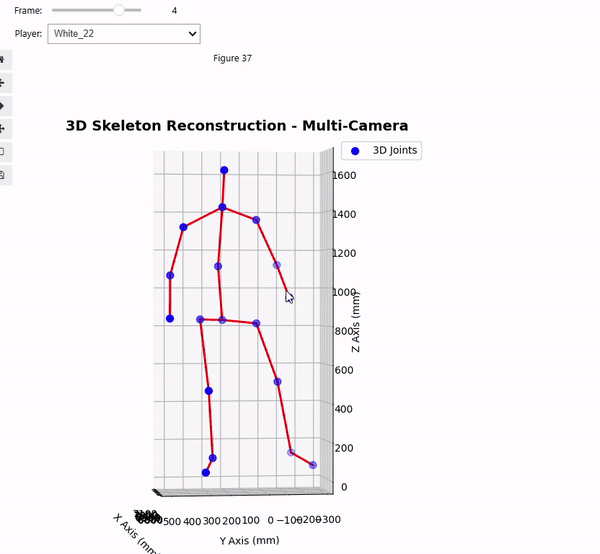

# Human Pose Estimation — HPE

This repository contains tools, scripts, and notebooks for multi-camera human pose estimation, including camera calibration, image rectification, bundle adjustment, and 3D triangulation. This project was developed as part of a Computer Vision course.

> Project for the *Computer Vision* course (A.Y. 2025/26), University of Trento.
> Authors: **Alessandro Rossi**, **Elia Santuari**.
> 📄 Full report: [`Report_CV_25_26_HPE_Rossi_Santuari.pdf`](Report_CV_25_26_HPE_Rossi_Santuari.pdf) · 🖥️ [Slide presentation](https://docs.google.com/presentation/d/1pU8Kgmj-zw3U1H4DiAGL8ceWuMZa5BOE2ZIvksFFy_Y/edit?usp=sharing)

## Repository Contents

### Main Notebooks
- `project.ipynb`: Main file that performs all project tasks step-by-step with detailed markdown explanations and visualizations.
- `bundle_adjustment.ipynb`: Notebook that performs Bundle Adjustment (BA) to optimize camera parameters using court reference points in `camera_data_custom_for_BA`. After execution, it saves the optimized parameters inside `camera_data_after_BA`.

### Scripts
- `rectify_images.py`: Image rectification script that loads camera parameters, rectifies the images in `dataset_roboflow/hpe_01.v1i.coco`, and stores the results inside `rectified_images`.

### Folder Structure
- `dataset_roboflow/`: Contains annotation data from Roboflow and the corresponding video frames.
- `rectified_images/`: Contains images rectified via the `rectify_images.py` script.
- `camera_data_with_Rvecs/` and `camera_data_with_Rvecs_2ndversion/`: Folders containing `camera_calib.json` files storing the camera parameters (other contents in these folders are not relevant to the project).
- `camera_data_custom_for_BA/`: Contains `camera_calib.json` and `img_points.json` files storing camera parameters and court points used to perform BA.
- `camera_data_after_BA/`: Folder containing the optimized camera parameters obtained after running Bundle Adjustment.
- `tests/`: Utility Python scripts used during project development.
- `litterature_sources/`: Folder containing literature and reference papers used for the project.
- `supplementary_results_material/`: Folder containing photos, videos and GIFs of the results.

## Prerequisites and Installation

To run the notebooks and scripts, ensure you have Python installed along with the required dependencies, for example:

```bash
pip install numpy opencv-python matplotlib scipy ipywidgets
```

 ## Usage 

 All core tasks and visualizations are performed in the two main notebooks: `project.ipynb` and `bundle_adjustment.ipynb`. Simply open and run them sequentially to view the results, interactive 3D widgets, and step-by-step explanations.

## Results Examples

### 3D Triangulation
3D animation showing the reconstructed human pose skeleton and camera positions after Bundle Adjustment:

<p align="center">
  
</p>

### 2D Reprojection
Animation showing the skeleton reprojected onto the video stream (Pre-BA on top and Post-BA below).

<p align="center">
  <b>Pre-BA</b><br>
  
</p>

<p align="center">
  <b>Post-BA</b><br>
  
</p>

### Bundle Adjustment example
In the image below are the reprojected 3D court points before and after Bundle Adjustment. The example shows Camera 5, which was one of the most critical views.

<p align="center">
  
</p>

### 3D skeleton of each player
With the interactive widget, one can visualize the reconstructed 3D skeleton of each player in every frame.

<p align="center">
  
</p>


